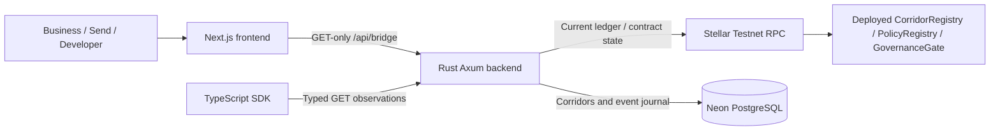

  

  **Confidential payments. Without borders.**

  Building the next generation of privacy-conscious cross-border payment experiences on Stellar.

  [Explore StealthBridge](https://stealthbridge.vercel.app/) · [Business](https://stealthbridge.vercel.app/business) · [Send](https://stealthbridge.vercel.app/send) · [Our platform](https://stealthbridge.vercel.app/platform)

---

## Stellar Testnet — three verified Soroban governance contracts

**CorridorRegistry, PolicyRegistry and GovernanceGate are now deployed on
Stellar Testnet.** Their actual C-addresses, successful transaction hashes,
bytecode readbacks and constructor bindings are documented in our
[verified Testnet release report](https://github.com/stealthbridge-labs/.github/blob/main/docs/SOROBAN-TESTNET-DEPLOYMENT-STATUS.md)
and [Contracts deployment receipts](https://github.com/stealthbridge-labs/stealthbridge-contracts/blob/main/deployments/testnet/VERIFIED-GOVERNANCE-RELEASE-2026-10-17.md).

The administrator is the secure-store CLI identity `operator_local` at
`GC3Y…NX5TN`. The older `GBBC…DLTE` Freighter wallet is a distinct account
and does not govern these instances. Only public governance is live; no private
asset transfer, custody, payout or platform fee collection is enabled.
The legacy v1 canonical deployment manifest is pending a reviewed three-contract
migration before frontend/backend/SDK may consume live addresses.

**End-to-end verified-read path:** protected `/preview/governance` → Next.js `GET /api/bridge/v1/governance/{release,code,admin}` → Rust/Axum backend → Testnet RPC / historical transaction receipts → public deployed Soroban instances. `/preview/activity` uses a bounded public observer journal backed by PostgreSQL. The TypeScript SDK validates the corresponding backend response models; the frontend does not request signing authority. See the [integration topology](https://github.com/stealthbridge-labs/.github/blob/main/docs/INTEGRATION-TOPOLOGY.md). Deployment does **not** mean confidential transfers or fee collection are live.

## Why StealthBridge?

Moving value across borders should feel connected and straightforward, without revealing more financial information than necessary. We're building a modular platform that brings together **thoughtful privacy, dependable settlement infrastructure, and product experiences designed for real businesses and people**.

## What we're building

| | Product | Purpose |
| :-- | :-- | :-- |
| 🏦 | **[StealthBridge Business](https://stealthbridge.vercel.app/business)** | Confidential settlement experiences for treasury teams, payment businesses and institutions, with oversight and reconciliation in mind. |
| 🌍 | **[StealthBridge Send](https://stealthbridge.vercel.app/send)** | A more personal, transparent and privacy-conscious way to approach international remittances. |
| 🧩 | **[StealthBridge Platform](https://stealthbridge.vercel.app/platform)** | Shared infrastructure for asset and corridor discovery, settlement orchestration, governance and developer integrations. |

## The StealthBridge ecosystem

Four focused repositories, designed to move together:

| Repository | Focus |
| :-- | :-- |
| [**Frontend**](https://github.com/stealthbridge-labs/stealthbridge-frontend) | Next.js product experiences, wallet UX and interactive web design |
| [**Backend**](https://github.com/stealthbridge-labs/stealthbridge-backend) | Rust services, settlement orchestration, persistence and Stellar network observations |
| [**Contracts**](https://github.com/stealthbridge-labs/stealthbridge-contracts) | Soroban governance, protocol research and smart-contract security |
| [**SDK**](https://github.com/stealthbridge-labs/stealthbridge-sdk) | TypeScript integrations, typed network clients and future contract adapters |

## How the architecture fits together

The frontend provides product experiences and consented, read-only wallet context. The backend owns Testnet observations, operator-configured corridor records and internal workflow foundations. The SDK exposes typed consumers. Soroban hosts three actually deployed, historically verified public governance contracts; the Rust API now exposes read-only deployment receipts and current code/administrator observations for the frontend preview.

**Where we are today:** the public site and gated engineering preview exist; the backend reads real Testnet network, governance and contract-activity observations; the SDK validates typed API evidence; and three public governance contracts have deployed Testnet IDs and observed code/admin state. **Where we are going:** a reviewed canonical three-contract manifest, independent release attestations, secure operator succession, wallet identity, verified privacy rails and production-grade reconciliation, then a separately gated financial release. No actual confidential payment or fiat payout is available yet.

Read the [complete platform architecture and milestones](https://github.com/stealthbridge-labs/.github/blob/main/docs/PLATFORM-VISION-AND-ARCHITECTURE.md), plus implementation-specific architecture guides for [frontend](https://github.com/stealthbridge-labs/stealthbridge-frontend/blob/main/docs/ARCHITECTURE-AND-DELIVERY.md), [backend](https://github.com/stealthbridge-labs/stealthbridge-backend/blob/main/docs/ARCHITECTURE-AND-DELIVERY.md), [SDK](https://github.com/stealthbridge-labs/stealthbridge-sdk/blob/main/docs/ARCHITECTURE-AND-DELIVERY.md), and [Soroban](https://github.com/stealthbridge-labs/stealthbridge-contracts/blob/main/docs/ARCHITECTURE-AND-DELIVERY.md).

## Open development

We're building in public and welcoming thoughtful engineering, product-design, documentation, accessibility and security contributions. Browse [open contributor issues](https://github.com/search?q=org%3Astealthbridge-labs+is%3Aissue+is%3Aopen&type=issues), read our [contribution guide](https://github.com/stealthbridge-labs/.github/blob/main/CONTRIBUTING.md), follow the [integration topology](https://github.com/stealthbridge-labs/.github/blob/main/docs/INTEGRATION-TOPOLOGY.md), or explore a repository's detailed README and roadmap.

StealthBridge is in active development; its planned financial services are not yet available for real-money payments.

---

**Move value. Not exposure.**

[Website](https://stealthbridge.vercel.app/) · [Engineering repositories](https://github.com/orgs/stealthbridge-labs/repositories) · [Contribute](https://github.com/stealthbridge-labs/.github/blob/main/CONTRIBUTING.md)

